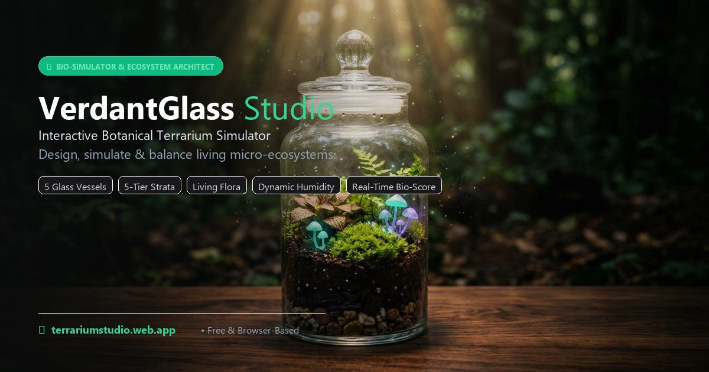

# VerdantGlass Studio 🌿

> **Interactive Botanical Terrarium & Micro-Ecosystem Architect**



<p align="center">
  <a href="https://terrariumstudio.web.app">
    
  </a>
  <a href="https://github.com/18basils/Terrarium-Studio/releases/tag/v1.0.0">
    
  </a>
  <a href="./LICENSE.md">
    
  </a>
  <a href="./SECURITY.md">
    
  </a>
  <a href="./CONTRIBUTING.md">
    
  </a>
  <a href="./CHANGELOG.md">
    
  </a>
  <a href="https://github.com/18basils/Terrarium-Studio/security/code-scanning">
    
  </a>
  <a href="https://react.dev/">
    
  </a>
  <a href="https://tailwindcss.com/">
    
  </a>
  <a href="https://vitejs.dev/">
    
  </a>
</p>

---

**VerdantGlass Studio** is an interactive, browser-based botanical terrarium simulator, bioactive landscape designer, and micro-ecosystem architect. Build, layer, and simulate custom living glass enclosures with procedural SVGs, real-time strata layering, micro-climate humidity and temperature controls, aquascaping composition guides, live plant stress diagnostics, procedural soundscapes, and an automated 1-click ecosystem balancing engine.

- 🌐 **Live Web Application**: [https://terrariumstudio.web.app](https://terrariumstudio.web.app)
- 📁 **GitHub Repository**: [https://github.com/18basils/Terrarium-Studio](https://github.com/18basils/Terrarium-Studio)
- 🚀 **Latest Release**: [`v1.0.0`](https://github.com/18basils/Terrarium-Studio/releases/tag/v1.0.0)
- 📱 **Installable Progressive Web App (PWA)**: Desktop & mobile offline-first support

---

## 📑 Table of Contents

- [✨ What's New in the Latest Release](#-whats-new-in-the-latest-release)
- [🏺 Architectural Glass Vessels & Finishes](#-architectural-glass-vessels--finishes)
- [🌿 "Inspire Me" Procedural Auto-Scaper](#-inspire-me-procedural-auto-scaper)
- [🪨 Substrate Strata System & Exploded X-Ray View](#-substrate-strata-system--exploded-x-ray-view)
- [🌸 Living Flora, Mineralia & Cultivar Variegation](#-living-flora-mineralia--cultivar-variegation)
- [📐 Aquascaping Composition Grids](#-aquascaping-composition-grids)
- [🌡️ Micro-Climate, Flora Stress & 1-Click Auto-Fix](#-micro-climate-flora-stress--1-click-auto-fix)
- [📖 Interactive DIY Physical Build Wizard](#-interactive-diy-physical-build-wizard)
- [📜 Botanical Care Passport & QR Gift Certificate](#-botanical-care-passport--qr-gift-certificate)
- [🛒 Nursery Bill of Materials (BOM) & Multi-Currency Engine](#-nursery-bill-of-materials-bom--multi-currency-engine)
- [📚 Botanical Intelligence & Care Encyclopedia](#-botanical-intelligence--care-encyclopedia)
- [🔊 Multi-Track Procedural Web Audio Soundscape](#-multi-track-procedural-web-audio-soundscape)
- [💡 Diurnal Day/Night Cycle & 6 Lighting Modes](#-diurnal-daynight-cycle--6-lighting-modes)
- [💾 Local Enclosure Archives & URL Deep-Linking](#-local-enclosure-archives--url-deep-linking)
- [⌨️ Keyboard Shortcuts & Canvas Precision Controls](#-keyboard-shortcuts--canvas-precision-controls)
- [🚀 Quick Start & Local Development](#-quick-start--local-development)
- [🛠️ Tech Stack](#️-tech-stack)
- [📄 Community Guidelines & Terms](#-community-guidelines--terms)
- [👨‍💻 Author & Maintainer](#-author--maintainer)

---

## ✨ What's New in the Latest Release

The latest release brings the complete **Phase 4 Upgrade Suite** to VerdantGlass Studio:

1. **Interactive DIY Physical Build Wizard**: 7-step physical build walkthrough with calculated substrate depths (mm) and masses (grams) tailored to your exact vessel.
2. **Exploded Strata X-Ray View**: Vertical mechanical separation of subterranean layers with caliper brackets and depth/mass indicators.
3. **"Inspire Me" Procedural Auto-Scaper**: 6 curated procedural themes with instant balancing and synthesized pentatonic wind-chimes.
4. **Aquascaping Composition Overlays**: Nature aquascaping guides (*Rule of Thirds*, *Golden Spiral*, *Triangular Depth Slope*).
5. **Live Flora Stress, Temperature Control ($15^\circ\text{C}-32^\circ\text{C}$) & 1-Click Auto-Fix**: Real-time chlorosis/wilt visual transforms on stressed flora, and a single-click auto-fix button that restores a 100/100 bio-harmony score.
6. **3 New Architectural Vessels, Glass Tints & Pedestal Bases**: Paludarium Waterfall Tank, Horizontal Cylinder "Ship-in-Bottle", Hexagonal Conservatory Lantern, 4 glass tints, and 5 display pedestals (including illuminated LED Halo).
7. **Specimen Variegation & Workflow**: Pin/Lock position (`isLocked`), specimen duplication (`Ctrl+D`), and cultivar color chips (Sakura Pink, Ruby Red, White Anne, Amethyst, Citrine, Scoria Red, etc.).
8. **Printable Botanical Care Passport & QR Gift Certificate**: High-res printable gift certificate with live scannable QR code deep-linking directly to your interactive 3D digital twin.

---

## 🏺 Architectural Glass Vessels & Finishes

VerdantGlass Studio features **8 mathematically proportioned architectural vessels**, each featuring dedicated SVG clipping paths, reflection sheens, and custom lid mechanics:

| Vessel | Style | Enclosure Type | Retention | Distinctive Characteristics |
| :----- | :---- | :------------- | :-------- | :-------------------------- |
| **Apothecary Jar** | Victorian Classic | Closed | $1.20\times$ | Cylindrical glass with fitted natural cork lid |
| **Geometric Wardian** | Victorian Faceted | Semi-Closed | $1.00\times$ | Hand-soldered brass frame & multi-faceted roof |
| **Hanging Aerium Globe** | Modern Minimalist | Open | $0.85\times$ | Spherical suspended glass with wide front portal & hanging chain |
| **Wide Bubble Bowl** | Open Air | Open | $0.75\times$ | Low-profile circular basin ideal for desert succulents |
| **Conical Erlenmeyer** | Laboratory Science | Closed | $1.25\times$ | Tapered borosilicate flask for high-humidity micro-mosses |
| **Paludarium Waterfall Tank** | Riparian Aquatic | Semi-Closed | $1.15\times$ | Half-aquatic tank with stone waterfall ledge & mist pool |
| **Horizontal Cylinder** | "Ship-in-Bottle" | Closed | $1.20\times$ | Panoramic horizontal cylinder with side borosilicate cork neck |
| **Hexagonal Lantern** | Gothic Conservatory | Semi-Closed | $1.05\times$ | 6-sided brass lantern with steeple roof & hanging ring |

### Glass Tints & Display Pedestals
- **Glass Tints**: *Borosilicate Clear*, *Apothecary Amber*, *Emerald Sea-Glass*, and *Obsidian Noir*.
- **Pedestal Bases**: *Walnut Hardwood*, *Brushed Brass*, *Carrara Marble*, *Illuminated LED Halo* (with cyan neon glow), and *Bare Glass*.

---

## 🌿 "Inspire Me" Procedural Auto-Scaper

Stuck on a blank canvas? Click the **"Inspire Me"** button in the header toolbar to trigger procedural auto-scaping. The generator randomly balances vessel geometry, substrate ratios, lighting schedules, and complementary flora and hardscape across 6 curated biomes:

| Theme | Recommended Vessel | Humidity & Climate | Bio-Harmony Focus |
| :---- | :----------------- | :----------------- | :---------------- |
| **Amazonian Canopy** | Apothecary Jar | $82\%\text{ RH}$ • $24^\circ\text{C}$ | Tropical high-canopy fern and jewel orchid symbiosis |
| **Carnivorous Mist Bog** | Conical Flask | $90\%\text{ RH}$ • $22^\circ\text{C}$ | Sphagnum-heavy bog environment for Dionaea & Drosera |
| **Kyoto Zen Moss Garden** | Geometric Wardian | $72\%\text{ RH}$ • $20^\circ\text{C}$ | Minimalist Japanese cushion moss, Ohko dragon stone, and river pebbles |
| **Sonoran Obsidian Canyon** | Wide Bubble Bowl | $28\%\text{ RH}$ • $26^\circ\text{C}$ | Porous volcanic lava rock with drought-tolerant desert succulents |
| **Bioluminescent Cavern** | Apothecary Jar | $76\%\text{ RH}$ • $21^\circ\text{C}$ | Shimmering spring basin, amethyst quartz crystals, and UV glowing fungi |
| **Cloud Forest Epiphyte Wall** | Paludarium Tank | $88\%\text{ RH}$ • $23^\circ\text{C}$ | Cascading riparian rock ledge with weeping epiphyte foliage |

Each auto-scape generation plays an uplifting pentatonic wind-chime synthesized in real time via the Web Audio API.

---

## 🪨 Substrate Strata System & Exploded X-Ray View

A healthy terrarium relies on a functional layered false bottom. The studio simulates a **5-tier bioactive strata system** with dynamic elevation physics: adjusting any substrate slider shifts rooted flora vertically to stay grounded on the soil horizon.

```
┌──────────────────────────────────────────────┐
│  5. Silica Desert Sand (Inert arid accent)    │
├──────────────────────────────────────────────┤
│  4. ABG Bio-Active Tropical Nutrient Soil    │
├──────────────────────────────────────────────┤
│  3. Long-Fiber Sphagnum Separation Mesh       │
├──────────────────────────────────────────────┤
│  2. Horticultural Activated Carbon Filter    │
├──────────────────────────────────────────────┤
│  1. Leca / Hydro-Pebble Drainage Basin        │
└──────────────────────────────────────────────┘
```

- **Exploded Strata X-Ray View**: Click the **X-Ray Strata** button to vertically separate the layers in isometric space, revealing caliper brackets displaying exact millimeter depths and calculated mass in grams.

---

## 🌸 Living Flora, Mineralia & Cultivar Variegation

All botanical and mineral elements are rendered procedurally using clean vector SVG definitions with support for UV fluorescence, time-lapse growth, and cultivar variegation:

- **Living Flora**:
  - *Fittonia Nerve Plant* (*Fittonia albivenis*): Available in **Sakura Pink**, **Ruby Red**, and **White Anne** cultivars.
  - *Polka Dot Plant* (*Hypoestes phyllostachya*): High-contrast speckled foliage with vibrant pink and magenta leaves.
  - *Mood Cushion Moss* (*Leucobryum glaucum*): Velvety moisture-retaining moss pillow with spore capsules.
  - *Crispy Wave Bird Fern* (*Nephrolepis exaltata*): Sculptural ruffled fronds with natural epiphyte crown.
  - *Mini Jewel Orchid* (*Phalaenopsis minima*): Electrified gold lightning leaf venation.
  - *Rosette Echeveria* (*Echeveria elegans*): Symmetrical blue-green desert succulent.
  - *Zebra Haworthia* (*Haworthiopsis attenuata*): Rigid structural succulent with raised pearl bands.
  - *Blushing Air Plant* (*Tillandsia ionantha*): Rootless epiphyte with trichome moisture scales.
  - *Venus Flytrap* (*Dionaea muscipula*): Carnivorous snapping traps with sensitive trigger cilia.
  - *Cape Sundew* (*Drosera capensis*): Glistening mucilage tentacles trapping micro-insects.
  - *String of Turtles* (*Peperomia prostrata*): Cascading succulent vine with intricate turtle-shell leaf markings.
- **Mineralia & Hardscape**:
  - *Ohko Dragon Stone*: Clay-formed perforated rock popular in Iwagumi aquascaping.
  - *Spiderwood Branch*: Intricate twisting root hardscape for climbing flora.
  - *Crystal Quartz*: Available in **Amethyst Purple**, **Rose Quartz**, **Milky White**, and **Citrine Gold**.
  - *Zen River Pebbles*: Smooth tumbled basalt stones with water line accents.
  - *Volcanic Lava Rock*: Porous aeration rock available in **Basalt Black**, **Scoria Red**, and **Pumice Grey**.
  - *Ancient Petrified Wood*: Fossilized prehistoric timber with striated rings and rich ochre grain.
  - *Canopy Forest Fungi*: Glowing bracket mushrooms that fluoresce under nocturnal UV illumination.
  - *Subterranean Crystal Pool*: Shimmering spring basin providing natural humidity buffering and water caustics.
- **Animated Bioactive Clean-Up Crew**:
  - Autonomous isopods and springtails that actively roam the substrate surface to cycle nutrients and prevent mold.

---

## 📐 Aquascaping Composition Grids

Align your layout with professional aquascaping and photographic design principles:

- **Rule of Thirds**: Overlays $3\times3$ compositional guidelines with 4 golden intersection nodes highlighting natural visual focal points.
- **Golden Spiral**: Renders a golden ratio logarithmic Fibonacci spiral directing the viewer's eye along a natural botanical curve to the focal apex.
- **Triangular Depth Slope**: Provides diagonal elevation slope guides used in nature aquariums to maximize optical depth in enclosed glass.

---

## 🌡️ Micro-Climate, Flora Stress & 1-Click Auto-Fix

- **Thermal Micro-Climate**: Regulate temperature from **$15^\circ\text{C}$ to $32^\circ\text{C}$** with color-coded status badges (Chilly $<18^\circ\text{C}$, Optimal $18^\circ\text{C}-27^\circ\text{C}$, Warm $>27^\circ\text{C}$).
- **Visual Flora Stress Shaders**: When the ecosystem score drops below 70, or when moisture/temperature conflicts occur, living flora display visual chlorosis (yellowing), desaturation, and wilting transformations.
- **1-Click Auto-Fix Ecosystem**: Click the glowing **Auto-Fix** button in the canvas toolbar or diagnostics card to automatically calibrate substrate depths, humidity, vessel type, and temperature for a perfect **100/100 Bio-Harmony Score**, accompanied by an ascending 4-note melodic chime.

---

## 📖 Interactive DIY Physical Build Wizard

Step-by-step physical assembly guide tailored to your exact vessel and selected materials:

1. **Vessel Prep**: Sterilization with 70% isopropanol and streak-free lint-free microfiber buffing.
2. **Drainage Leca**: False-bottom reservoir depth and mass calculation (e.g. `~38mm` / `~312g`).
3. **Charcoal Shield**: Horticultural steam-activated carbon layer to filter anaerobic toxins and odors.
4. **Sphagnum Mesh**: Dampened Grade-AAA sphagnum barrier preventing soil infiltration into the reservoir.
5. **Tropical Soil**: Atlanta Botanical Garden (ABG) bioactive substrate sloped for depth.
6. **Hardscape & Flora**: Tweezers positioning for structural hardscape, roots divots, and dowel tamping.
7. **Hydration & Seal**: Acclimation misting protocol, target humidity, and morning condensation monitoring.

---

## 📜 Botanical Care Passport & QR Gift Certificate

Create an artisan gift certificate ready to print or export to PDF:

- **Custom Dedication**: Enclosure title, recipient name, and artisan signature.
- **Micro-Climate Manifest**: Target humidity, optimal temperature, glass tint, and vessel type.
- **Botanical Registry Table**: Complete species list, scientific taxonomy, cultivars, and watering schedule.
- **Interactive QR Code**: Scannable cryptographic QR code generated directly from your build state that deep-links to [https://terrariumstudio.web.app](https://terrariumstudio.web.app) and loads your exact living 3D digital twin.
- **Print Optimization**: Dedicated `@media print` stylesheets isolate the certificate on clean white parchment with crisp gold borders.

---

## 🛒 Nursery Bill of Materials (BOM) & Multi-Currency Engine

- **Automated Local Currency Detection**: Automatically formats all pricing in your local currency across **16 global currencies** (**USD, AED, EUR, GBP, INR, CAD, AUD, SAR, QAR, KWD, OMR, BHD, SGD, JPY, CHF, BRL**) based on browser locale, timezone, and internationalization APIs.
- **Material Mass & Volume**: Live grams and liters calculations for all substrates.
- **Interactive Shopping Checklist**: Check off items as you source them, with 1-click clipboard export and print formatting.

---

## 📚 Botanical Intelligence & Care Encyclopedia

Integrated encyclopedia featuring **20 detailed botanical & mineral dossiers**:
- Taxonomy, family, and common names
- Light exposure requirements & photoperiods
- Watering intervals & humidity tolerances
- Temperature bounds & dormancy cycles
- Propagation techniques (cuttings, division, spores)
- Live search query and biome filtering (Tropical, Arid, Epiphyte, Carnivorous)

---

## 🔊 Multi-Track Procedural Web Audio Soundscape

Synthesized directly in the browser using the Web Audio API without pre-recorded MP3 samples:
- **432 Hz Zen Singing Bowl**: Resonant harmonic bell played upon launch and template selection.
- **Canopy Wind Breeze**: Pink noise generator routed through a resonant lowpass filter ($420\text{ Hz}$, $Q=2.2$).
- **Nocturnal Crickets**: Frequency-modulated dual-oscillator chirps ($4650\text{ Hz}$, $12\text{ Hz}$ LFO) active during dusk, night, and UV modes.
- **Micro-Mist Spray**: High-frequency white-noise burst simulating aerosol droplets.
- **Ascending Chord Chime**: Uplifting harmonic sequence played when achieving 100% ecosystem balance.

---

## 💡 Diurnal Day/Night Cycle & 6 Lighting Modes

- **Automatic Diurnal Cycle**: 24-minute accelerated day/night progression simulating sunrise, midday, sunset, dusk, midnight, and dawn.
- **Manual Lighting Overrides**:
  - **Dawn** (06:30 Sunrise): Warm rose-gold ambient glow and horizon morning light rays.
  - **Daylight** (12:00 Solar Noon): Crisp sunlit illumination ($5500\text{ K}$) with clean glass reflection sheens.
  - **Golden Hour** (17:45 Sunset): Warm amber and orange sunset tones with dramatic low-angle light rays.
  - **Twilight** (20:15 Dusk): Soft violet and indigo evening ambiance.
  - **Moonlight** (23:30 Midnight): Nocturnal deep indigo and celestial blue rays.
  - **UV Bio-Glow** (02:45 Phosphor): Fluorescent blacklight exciting neon minerals, crystals, and glowing mushroom caps.

---

## 💾 Local Enclosure Archives & URL Deep-Linking

- **Continuous Auto-Save**: Background state synchronization to local browser storage (`verdantglass_autosave`) ensuring zero loss of work on page reload or accidental tab closure.
- **Named Enclosure Archives**: Save unlimited custom designs locally to your browser (`localStorage`) with custom labels and timestamps.
- **URL Hash Compression (`#build=...`)**: Encodes the complete enclosure state (vessel, substrate depths, item positions, rotation, scaling, lighting, and climate) into a Base64-compressed URL hash for instant sharing.
- **30-Step Undo / Redo History**: Full state snapshots tracking every placement, rotation, and slider adjustment.

---

## ⌨️ Keyboard Shortcuts & Canvas Precision Controls

| Shortcut | Action | Description |
| :------- | :----- | :---------- |
| `Ctrl + Z` / `Cmd + Z` | **Undo** | Step backward in your 30-snapshot history stack |
| `Ctrl + Y` / `Cmd + Shift + Z` | **Redo** | Step forward in history |
| `Ctrl + D` / `Cmd + D` | **Duplicate** | Clone the currently selected item with offset |
| `F` / `Esc` | **Zen Mode** | Toggle distraction-free full-canvas sanctuary view (or press Esc to exit) |
| `Space` | **Mist Spray** | Spritz micro-droplets and increase humidity by 3% |
| `P` | **Pin / Lock** | Toggle position lock (`isLocked`) on selected item |
| `+` / `-` | **Zoom** | Scale canvas viewport from 75% to 200% |

---

## 🚀 Quick Start & Local Development

### Prerequisites
- **Node.js**: v18.0 or higher
- **npm**: v9.0 or higher

### Installation

```bash
# 1. Clone the repository
git clone https://github.com/18basils/Terrarium-Studio.git
cd Terrarium-Studio

# 2. Install dependencies
npm install

# 3. Start the Vite development server
npm run dev
```

Open `http://localhost:5173/` in your browser.

### Production Build & Linting

```bash
# Static linting with Oxlint
npm run lint

# Compile production bundle
npm run build

# Preview production build locally
npm run preview
```

### Deployment to Firebase Hosting

```bash
# Login to Firebase CLI
npx firebase-tools login

# Deploy production assets to Google Cloud CDN
npx firebase-tools deploy --only hosting --project terrariumstudio
```

---

## 🛠️ Tech Stack

- **Core Framework**: [React 19](https://react.dev/) + [Vite 8](https://vitejs.dev/) (Multi-Chunk Parallel Code Splitting)
- **Styling**: [Tailwind CSS v4](https://tailwindcss.com/)
- **Iconography**: [Lucide React](https://lucide.dev/)
- **QR Code Engine**: [QRCode](https://github.com/soldair/node-qrcode)
- **Vector Graphics**: Procedural SVG Virtual DOM Engine
- **Audio Synthesizer**: Native Web Audio API (`AudioContext`, `BiquadFilterNode`, `OscillatorNode`)
- **Persistence**: LocalStorage Engine (Continuous Auto-Save) + Base64 Compressed URL Hash Deep-Linking
- **PWA Runtime**: Service Worker + Web App Manifest
- **Code Security & Auditing**: GitHub CodeQL Static Analysis + Dependabot Automated CVE Fixes
- **Hosting**: [Firebase Hosting](https://firebase.google.com/docs/hosting) (Global SSD CDN with automated SSL & Hardened CSP)

---

## 📄 Community Guidelines & Terms

| Document | Purpose | Link |
| :------- | :------ | :--- |
| ⚖️ **License Terms** | Proprietary ownership, terms of use & restrictions | [`LICENSE.md`](./LICENSE.md) |
| 🛡️ **Security Policy** | Vulnerability disclosure, response timeline & architecture | [`SECURITY.md`](./SECURITY.md) |
| 🤝 **Contributing Guide** | Development setup, code conventions & PR workflow | [`CONTRIBUTING.md`](./CONTRIBUTING.md) |
| 📜 **Changelog** | Version history, releases & notable changes | [`CHANGELOG.md`](./CHANGELOG.md) |

---

## 👨‍💻 Author & Maintainer

Crafted with care by **Basil Shaji** ([@18basils](https://github.com/18basils)).

- GitHub: [https://github.com/18basils](https://github.com/18basils)
- Live Project: [https://terrariumstudio.web.app](https://terrariumstudio.web.app)
